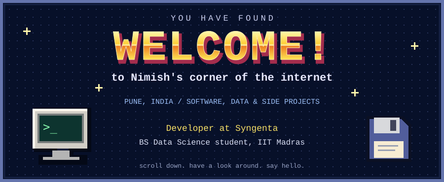

  
    
  <samp>Hi, I'm Nimish. I write Python, SQL, and the occasional PowerShell script.</samp>
   
  <samp>This is where my side projects live.</samp>
    

<table width="100%">
<tr>
<td width="50%" align="center">
<h3>💾 FocusDaddy</h3>

A Windows focus timer that blocks distracting websites and apps.

<samp>PowerShell · Windows automation</samp>

<a href="https://github.com/whynimoisalive/FocusDaddy"><strong>[ OPEN PROJECT ]</strong></a>

</td>
<td width="50%" align="center">
<h3>📄 IITM PYQ Converter</h3>

Remove answer ticks and crosses from question-paper PDFs before practising.

<samp>Python · PDF processing</samp>

<a href="https://github.com/whynimoisalive/IITM-PYQ-CONVERTOR"><strong>[ OPEN PROJECT ]</strong></a>

</td>
</tr>
<tr>
<td width="50%" align="center">
<h3>🛰️ Remote-sensing experiments</h3>

Exploring infrastructure extraction from satellite imagery.

<samp>Python · Machine learning</samp>

<a href="https://github.com/whynimoisalive/Goofy-HighRes-ML"><strong>[ OPEN PROJECT ]</strong></a>

</td>
<td width="50%" align="center">
<h3>🗂️ The rest of the folder</h3>

Other experiments, student tools, and things I've tried building.

<samp>Some finished. Some still experiments.</samp>

<a href="https://github.com/whynimoisalive?tab=repositories"><strong>[ BROWSE FILES ]</strong></a>

</td>
</tr>
</table>

<strong>📓 A little more about me</strong>

I'm based in Pune. At Syngenta, I work on Python and SQL tooling for data migration and validation. My employer's code and data stay private.

I'm also studying Data Science and Applications at IIT Madras. Outside coursework, I've worked on student platforms, hackathon tools, and InfinAI, a student AI/ML club I founded.

Most of my work uses **Python, SQL, Databricks, React, and TypeScript**.

 

  <h3>📖 Guestbook</h3>
  
Found a bug? Have an idea? Just passing through?

  <a href="https://github.com/whynimoisalive/whynimoisalive/issues/new?title=Hello%20Nimish"><strong>[ LEAVE A NOTE ]</strong></a>
    
  <samp>Thanks for stopping by!</samp>
    
  <kbd>HAND-CODED</kbd> &nbsp; <kbd>NO VISITOR COUNTER</kbd> &nbsp; <kbd>BEST VIEWED WITH CURIOSITY</kbd>
    
  Layout inspired by <a href="https://github.com/BrunnerLivio">BrunnerLivio</a>. Original graphics, no copied artwork.

