  

  <a href="#approach">approach</a> &nbsp; / &nbsp;
  <a href="#selected-work">selected work</a> &nbsp; / &nbsp;
  <a href="#toolkit">toolkit</a> &nbsp; / &nbsp;
  <a href="#beyond-the-code">beyond the code</a>

### approach

I'm Nimish, a developer at **Syngenta** and a **BS Data Science and Applications student at IIT Madras**, based in Pune, India.

I work across data engineering, applied AI, and full-stack applications. My current work includes Python and SQL tooling for Redshift-to-Databricks migration, query reconciliation, and data-quality validation. I'm especially interested in AI systems grounded in metadata, with clear explanations and deterministic checks.

I like building things, then understanding why they work.

### selected work

**01 / [FocusDaddy](https://github.com/whynimoisalive/FocusDaddy)**  
A Windows focus-session tool with website and app blocking, configurable sessions, and recovery controls. Built around making deliberate focus practical on a real desktop.  
PowerShell · JSON · Windows automation

**02 / [IITM PYQ Converter](https://github.com/whynimoisalive/IITM-PYQ-CONVERTOR)**  
A PDF utility that removes ticks and crosses from previous-year question papers, with a black-and-white option for preparing practice copies.  
Python · PDF processing · Student tools

**03 / [Remote-sensing ML](https://github.com/whynimoisalive/Goofy-HighRes-ML)**  
An exploratory project investigating infrastructure-feature extraction from high-resolution satellite imagery. A space for learning and testing geospatial ML ideas, not a claimed production deployment.  
Python · Machine learning · Geospatial imagery

### toolkit

| data & AI | applications | engineering |
| :--- | :--- | :--- |
| Python · SQL | FastAPI · Streamlit | Git · Linux |
| Databricks · Redshift | React · Next.js | Docker · PostgreSQL |
| Pandas · PyTorch | TypeScript | SQLite |

### beyond the code

My student-community work includes Tech Society platforms, hackathon tooling, and founding **InfinAI**, an AI/ML club. I enjoy turning complicated workflows into tools people can actually use.

I'm interested in **software engineering, data engineering, and applied AI** opportunities where correctness, clear explanations, and useful interfaces matter.

---

Public projects and experiments only. Employer code, datasets, and internal documentation stay private.

Visual template: <a href="https://github.com/beydemirfurkan/awesome-github-profile/tree/main/templates/06-designer-portfolio/glassmorphism-hero">Glassmorphism Hero</a> · personalized with the original layout and animation preserved.
