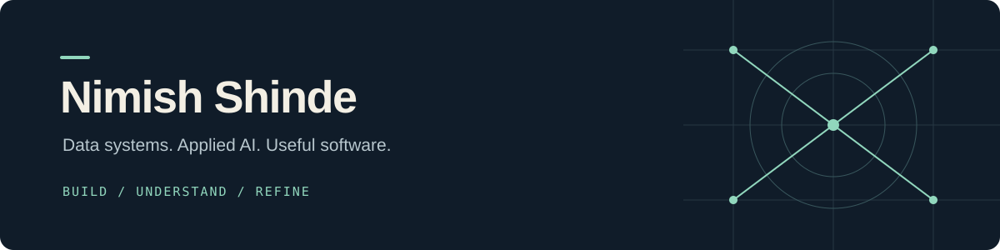

Developer at **Syngenta** · BS Data Science & Applications, **IIT Madras**  
Pune, India

*I like building things—and understanding why they work.*

---

### What I work on

Python and SQL for data migration and analytics. Metadata-grounded AI tools. Full-stack applications that make complex workflows easier to use.

At Syngenta, my focus includes Redshift-to-Databricks migration, query reconciliation, and data-quality validation. Outside work, I explore local LLM evaluation, machine learning, and tools for students.

### Selected public work

| Project | The idea | Built with |
| :--- | :--- | :--- |
| **[FocusDaddy](https://github.com/whynimoisalive/FocusDaddy)** | A Windows focus-session tool with website/app blocking, configurable sessions, and recovery controls. | PowerShell · JSON |
| **[IITM PYQ Converter](https://github.com/whynimoisalive/IITM-PYQ-CONVERTOR)** | A utility for cleaning ticks and crosses from previous-year question papers and preparing PDFs for practice. | Python · PDF processing |
| **[Remote-sensing ML](https://github.com/whynimoisalive/Goofy-HighRes-ML)** | An exploratory project on extracting infrastructure features from high-resolution satellite imagery. | Python · ML · Geospatial data |

### My toolkit

**Data & AI**  
Python · SQL · Databricks · Amazon Redshift · Pandas · PyTorch

**Applications**  
FastAPI · Streamlit · React · Next.js · TypeScript

**Engineering**  
Git · Linux · Docker · PostgreSQL · SQLite

### Beyond the code

I study Data Science and Applications at IIT Madras. My student-community work includes Tech Society platforms, hackathon tooling, and founding **InfinAI**, an AI/ML club.

I'm interested in **software engineering, data engineering, and applied AI**—especially work where correctness, clear explanations, and useful interfaces matter.

---

Public projects and experiments live here. Employer code, datasets, and internal documentation do not.
